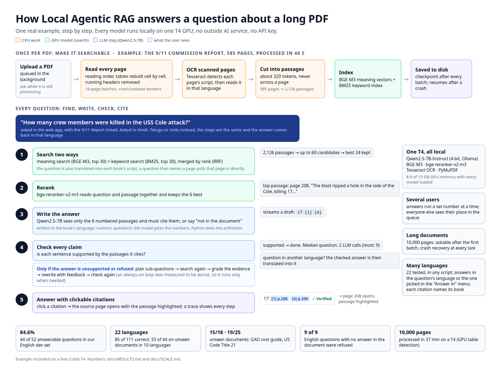
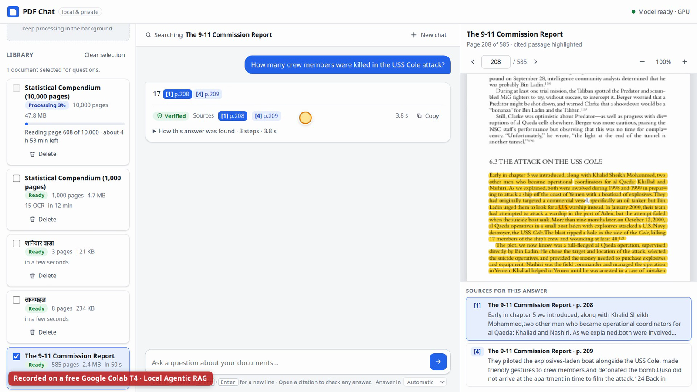
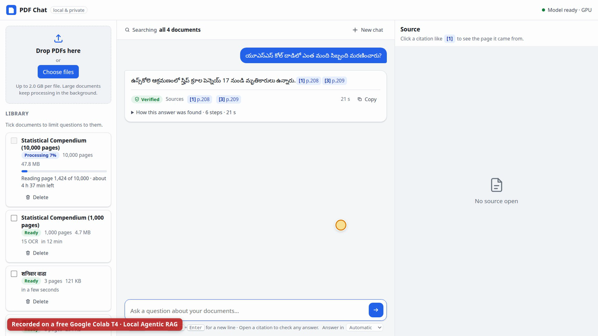

# Local Agentic RAG

[](https://colab.research.google.com/github/satyampandey1411/local-agentic-rag/blob/main/notebooks/Quick_Start.ipynb)

**[▶ Watch the 10-minute demo video](https://github.com/satyampandey1411/local-agentic-rag/releases/download/v1.0/Local_Agentic_RAG_Demo.mp4)** · [Animated architecture walkthrough](https://raw.githack.com/satyampandey1411/local-agentic-rag/main/docs/architecture.html)

**Ask questions about any PDF, even a 10,000-page one, in your own language, and get answers with page
citations you can click.** Every model runs locally on a single T4 GPU (free Google Colab or Kaggle). No
outside AI service, no API key.

| | |
|---|---|
| **84.6%** of answerable English questions correct (44/52) | **9/9** questions with no answer in the document refused |
| **15/18 · 19/25 · 9/14** on three held-out documents never used for tuning | **1/52** with the same model and no documents: answers come from retrieval |
| **22 languages tested**: 85/111 correct, 117/122 answered in the right script; **33/44** and **18/20** on two sealed sets of unseen documents in 16 languages | **10,000 pages** processed in 37 min on a T4, with crash recovery |
| **0.5 s** median to the first words of an answer | **8.9 of 15 GB** GPU memory with every model loaded |

All numbers are measured on Tesla T4 GPUs; how and where is in
[docs/RESULTS.md](docs/RESULTS.md) and [docs/SCALE.md](docs/SCALE.md).



## Try it in about five minutes

1. Press **Open in Colab** above (it opens `notebooks/Quick_Start.ipynb`).
2. If Colab did not pick it already: **Runtime → Change runtime type → T4 GPU**.
3. Press **Run**. The first start installs the app and downloads the models (about 5 minutes).
4. The app opens under the cell. Upload PDFs, ask a question, click a citation to see the page.

Other ways to run it (Docker, pip, Python) are in [Run it](#run-it).

## What it does

- **Answers with sources.** The language model sees only numbered passages from your PDF and must cite
  them. Every citation (`[1] p.208`) opens the page with the passage highlighted. If the document does
  not say, the answer says so.
- **Checks itself.** A verifier tests every claim against the passages it cites. Only when an answer
  fails that check, or refuses, does the agent plan sub-questions, search again and rewrite. An
  always-on loop was measured to be worse, so the extra work runs only when needed.
- **Reads real documents.** Two-column papers in reading order, tables rebuilt cell by cell, running
  headers removed, scanned pages read with OCR.
- **Works in many languages.** Upload a book in one language and ask in another; the answer comes back
  in your language, or the one you pick. See [Languages: common questions](#languages-common-questions).
- **Handles long PDFs.** Pages are processed in batches by crash-isolated workers with a checkpoint
  after every batch. A 10,000-page PDF can be asked about after its first batch, and an interrupted job
  resumes where it stopped.
- **Serves several people.** A web app with a background processing queue, live progress, streaming
  answers, a fair queue for questions and an optional access token.
- **Does arithmetic in Python.** For numeric questions the model picks the numbers with their
  citations, each number is checked against its table cell, then Python computes.

## Languages: common questions

**Which PDFs can I upload?** Any language whose text is stored as Unicode. Tested on 22: Hindi, Marathi,
Sanskrit, Nepali, Bhojpuri, Awadhi, Maithili, Urdu, Bengali, Telugu, Tamil, Kannada, Malayalam, Gujarati,
Punjabi, Odia, English, French, Arabic, Chinese, Japanese and Russian. Scanned (image-only) pages are read
with OCR: the script of each page is detected first, then the matching language is used. Old Hindi PDFs
typed in legacy fonts (Kruti Dev, DevLys, Chanakya) are also sent to OCR, because their text is not
real Unicode.

**Which languages can I ask in? Does it have to be the book's language?** Any language, and no. A Telugu
question about a Sanskrit book, an English question about a Hindi book and a Hindi question about an
English book all work. Indian languages typed in Latin letters (Hinglish, Roman Urdu) work too.

**Which language is the answer in? Can I choose?** By default, the language of your question. To choose,
say it in the question ("Answer in Urdu", "उर्दू में बताइए") or pick it in the app's **Answer in** menu
under the question box. When the book and the answer are in different languages, the answer is
written and checked in the book's language first, then translated, so the facts come from the book.

**I uploaded ten books. Which one answers? Do I have to tick it?** No ticking needed: every ready book is
searched and the passages that fit best are used, whatever their language. In the 22-book test the
right book was cited for 21 of 21 questions. Tick books on the left only to limit the search. The
**Sources** list names the book and page of every citation.

**Can one answer use two books?** Yes; the search keeps room for a second book that matches well. This
is the weakest case so far: 1 of 6 two-book questions fully right, 3 of 6 citing both books.

**How well does it work?**

| Kind of question (122 questions, Kaggle T4) | Correct |
|---|---:|
| Question in the document's language | 21/21 |
| English question about a non-English document | 16/20 |
| Question in another non-English language (Telugu about a Sanskrit book, Urdu about a Hindi one, ...) | 12/21 |
| Asks for the answer in another language ("Answer in Urdu"): correct · in the asked language | 7/8 · 7/8 |
| All 22 books searched at once: correct · cited the right book | 19/21 · 21/21 |
| Needs one fact from each of two books in different languages: correct · cited both books | 1/6 · 3/6 |
| Scanned (image-only) copy | 9/14 |
| Not in the document: refused | 9/11 |
| **All answerable** · answers written in the right script (all 122) | **85/111 · 117/122** |

Only 4 of the 111 answerable questions were wrongly refused. On documents written and sealed before
any result was seen, and run once: **33/44** on ten (Hindi, Marathi, Nepali, Awadhi, Maithili, Bengali,
Kannada, Malayalam, Odia, Japanese, with four scanned copies) and **18/20** on six (Sanskrit, Bhojpuri,
Urdu, Telugu, Tamil, French). Per-language tables and caveats:
[docs/RESULTS.md](docs/RESULTS.md#8b-many-languages).

**What does not work well yet?** Questions in a different non-English language from the book (12/21)
and two-book questions (1/6): the right passages are found, but the 7B answer model misreads them in
low-resource languages. A larger model fixes much of this: Gemma-3-12B scored 101/111 on the same
questions (19/21 and 5/6), but refused fewer unanswerable questions (6/11), so it is not the default yet.

## How it works

```
 Once per PDF                                         Every question
 ─────────────                                        ──────────────
 PDF ─► read pages (PyMuPDF workers, OCR by script)    question ─► search two ways: BGE-M3 meaning (top 30)
     ─► passages ≤320 tokens, never across a page                  + BM25 keywords (top 30) ─► RRF ─► 24
     ─► BGE-M3 vectors + BM25 keyword index                     ─► bge-reranker-v2-m3 ─► best 6
     ─► on disk, checkpoint after every batch                   ─► Qwen2.5-7B writes, citing [n] ─► verify
                                                                ─► fails? plan ─► search again ─► grade ─► rewrite
                                                                ─► other language? translate ─► answer with page citations
```

| Part | Model (all local, open weights) | Where it runs |
|---|---|---|
| Answer writing, checking, planning, translation | Qwen2.5-7B-Instruct, 4-bit (Q4_K_M), served by Ollama | GPU |
| Meaning search | BAAI/bge-m3 (100+ languages) | GPU |
| Reranking | BAAI/bge-reranker-v2-m3 | GPU |
| Keyword search | BM25 with a Unicode-aware tokenizer | CPU |
| Scanned pages | Tesseract OCR: script detected per page, then the matching language pack | CPU |
| Table detection | PyMuPDF's layout model (optionally on the GPU) | CPU or GPU |

The design, and the measurement behind each choice, is in [docs/ARCHITECTURE.md](docs/ARCHITECTURE.md).

## Results

**English** (61 questions over 3 public PDFs; a validator checks every required fact on its cited page)
and **Hindi/Marathi/Hinglish** (20 questions):

| | English | Hindi / Marathi / Hinglish |
|---|---|---|
| Right page in the top 5 | **94.2%** (top 1: 68.3%); a basic MiniLM search: 73.1% | **1.000**; English-only search models: 0.944 |
| Answers correct | **84.6%** (44/52, 95% CI 73.1–94.2); single pass without the agent 71.2%; a simple baseline (MiniLM search, no reranker, no agent) 50.0% | **16–17 / 18** across runs |
| Unanswerable questions refused | 9 / 9 | 2 / 2 |

**Documents never used for tuning** (each question set used once):

| Document | Pages | Answerable correct | Unanswerable refused |
|---|---:|---:|---:|
| GAO Cost Estimating and Assessment Guide | 476 | 15 / 18 | 2 / 4 |
| US Code Title 21 (Food and Drugs) | – | 19 / 25 | 4 / 5 |
| CAG audit report on GST, in Hindi | 190 | 9 / 14 | 2 / 4 |

**Is it answering from memory?** No. With the same 61 questions and no document passages, Qwen2.5-7B got
1/52 right.

**Long documents** (synthetic table-heavy PDFs with 40 independently written questions per size, Kaggle T4):

| | 100 pages | 1,000 pages | 10,000 pages |
|---|---:|---:|---:|
| Processing time, table detection on the GPU | 30 s | 3.8 min | 37 min |
| Processing time, table detection on the CPU (default) | 55 s | 5.7 min | 71 min |
| Right page in top 5 / answers correct | 0.97 / 0.75 | 0.94 / 0.72 | 0.89 / 0.72 |
| Median answer time | 6.3 s | 6.1 s | 6.0 s |
| Index on disk / load time | 2 MB / 0.0 s | 19 MB / 0.1 s | 189 MB / 0.9 s |

At every size a parse worker was killed mid-page and a job was interrupted half-way; both recovered. The
web app served 1 to 8 concurrent users with no failed request, at about 10.5 answers per minute on one T4.

<details>
<summary><b>Which answer model?</b> Five models compared on the same retriever and prompts</summary>

Only the language model swapped (Kaggle T4):

| Answer model (4-bit) | English correct | Unanswerable refused | Hindi/Marathi correct | Median answer time | Peak GPU memory |
|---|---:|---:|---:|---:|---:|
| **Qwen2.5-7B-Instruct (chosen)** | **44/52** | **9/9** | **17/18** | **6.9 s** | 9,345 MiB |
| Llama-3.1-8B | 44/52 | 6/9 | 17/18 | 15.0 s | 10,103 MiB |
| Gemma-2-9B | 44/52 | 9/9 | 17/18 | 10.7 s | 12,045 MiB |
| Mistral-7B-Instruct | 39/52 | 9/9 | 12/18 | 9.8 s | 9,799 MiB |
| Qwen2.5-3B-Instruct | 29/52 | 8/9 | 11/18 | 5.3 s | 6,731 MiB |

Three models tie on accuracy. Qwen2.5-7B refuses every unanswerable question, is the fastest of the three
and uses the least memory. The prompts were developed with Qwen, which may favour it. On the 22-language
set: Qwen2.5-7B 85/111, Qwen3-8B 93/111, Gemma-3-12B 101/111 (unanswerable refused 9/11, 8/11,
6/11).

</details>

**Still weak** (also measured): questions that combine facts from several pages (5/9) or two books in
different languages (1/6), questions in a different non-English language from the book (12/21),
questions that assume something the document does not say (6/9 refused on real documents), and the
numeric fixes were tuned on the English set and showed no gain on synthetic documents. Full list in
[docs/STATUS.md](docs/STATUS.md).

## The web app



- Upload PDFs of any length (streamed to disk, 2 GB limit by default) and watch them process with live
  progress and an estimate of the time left.
- Ask across any set of ticked documents, including one that is still processing; the answer then says
  "answered from the first n of N pages".
- Answers stream word by word, then are replaced by the verified answer with its citations and a
  "how this answer was found" trace. Click a citation to open the page with the passage highlighted.
- **Answer in** menu under the question box: Automatic (the question's language) or any of about 30
  languages.
- Listens on 127.0.0.1 unless you pass `--host`. `--token` (or `LOCAL_RAG_TOKEN`) requires an access
  token for every API call; uploads are limited per client address.



## Run it

**Google Colab, quickest:** press the **Open in Colab** button at the top and press **Run** (see
[Try it](#try-it-in-about-five-minutes)).

**Google Colab, full notebook:** open `notebooks/Local_Agentic_RAG.ipynb`, choose **Runtime → Change
runtime type → T4 GPU** and run the cells in order. It installs the package, starts Ollama with
Qwen2.5-7B, lets you upload a PDF and ask questions, starts the web app through Colab's port proxy
(section 7b) and can reproduce the benchmarks.

**Docker (GPU machine):**

```bash
docker compose up --build            # web app, Ollama and the model; open http://127.0.0.1:8000
scripts/smoke_install.sh             # optional end-to-end check of the install
```

Without an NVIDIA GPU, add `-f docker-compose.cpu.yml` (works, but slowly: a one-page PDF took 40 s from
upload to a cited answer on a 16-core laptop CPU). The image was built and passed the smoke test with the
real 7B model on a CPU host; the GPU path inside Docker has not been tested yet. Requirements, options and
security notes: [docs/DEPLOY.md](docs/DEPLOY.md).

**pip + Ollama:**

```bash
pip install -e ".[web]"
ollama serve & ollama pull qwen2.5:7b-instruct
python -m local_agentic_rag.server --library ~/rag-library --port 8000   # open http://127.0.0.1:8000/
```

`python -m local_agentic_rag.server --demo` runs the interface with a fake backend, no GPU needed.
`LOCAL_RAG_ONNX_GPU=1` runs table detection on the GPU, 1.9× faster on table-heavy PDFs
([details](docs/DEPLOY.md#faster-table-detection-on-a-gpu)).

<details>
<summary><b>From Python</b></summary>

```python
from local_agentic_rag.config import RAGConfig
from local_agentic_rag.pipeline import RAGPipeline
from local_agentic_rag.llm.ollama import OllamaLLM

llm = OllamaLLM("qwen2.5:7b-instruct"); llm.ensure_ready()
pipe = RAGPipeline(RAGConfig(), llm=llm)
pipe.ingest("report.pdf")
ans = pipe.ask("What was revenue growth in 2024?")
print(ans.answer, ans.cited_pages, ans.grounded)
follow = pipe.ask("And in 2023?", history=[("What was revenue growth in 2024?", ans.answer)])
```

</details>

<details>
<summary><b>Reproduce the benchmarks</b></summary>

```bash
python benchmark/fetch_pdfs.py                        # the 3 public PDFs, sha256-checked
python -m local_agentic_rag.bench retrieval           # retrieval ablation; a CPU is enough
python -m local_agentic_rag.bench answer --llm ollama:qwen2.5:7b-instruct
python -m local_agentic_rag.bench answer --benchmark-dir benchmark/multilingual --configs agentic agentic_en
python benchmark/languages/run.py --set dev --out local/languages/dev.jsonl   # the 22-language set
```

Long documents (100 to 10,000 pages):

```bash
python benchmark/scale/make_corpus.py --pages all --out local/scale/corpus     # synthetic, facts planted
python benchmark/scale/run_scale.py --tiers 100 250 1000 2500 5000 10000 \
    --llm ollama:qwen2.5:7b-instruct --recovery --out local/scale/results
python benchmark/scale/run_realdocs.py --llm ollama:qwen2.5:7b-instruct       # real public-domain PDFs
python benchmark/scale/load_test.py --url http://127.0.0.1:8000 --users 1 2 4 8 \
    --questions local/scale/corpus/scale-1000.questions.jsonl
```

`run_scale.py` records processing time per stage, peak RAM and GPU memory, index size, load time, retrieval
and answer quality by question type and page depth, and failure recovery. Sizes that were not run are
reported as "not run". See [benchmark/scale/README.md](benchmark/scale/README.md) for what the synthetic
corpus contains and its limits.

</details>

<details>
<summary><b>Repository layout and development</b></summary>

```
src/local_agentic_rag/
  ingest/       PDF reading, tables, OCR, chunking, streaming checkpointed ingestion
  retrieval/    BGE-M3 embedder, BM25, fusion, reranker, on-disk index
  agent/        prompts, citations, calculator, the adaptive agent
  llm/          Ollama and llama.cpp backends
  server/       FastAPI web app and its offline single-page frontend
  library.py    document library: catalog, background queue, answers, page images
  lang.py       language detection, answer language, translation prompts
  eval/, bench.py   benchmark runner and metrics
benchmark/      question sets, validators, scale and load tests
notebooks/      the Colab / Kaggle notebooks
docs/           architecture, results, scale, deployment, status
report/         project report (LaTeX source and PDF)
tests/          offline test suite (models are faked)
```

```bash
python -m venv .venv && . .venv/bin/activate
pip install -e ".[dev,web]"
pytest -q              # 959 offline tests, about 2 min, no downloads
ruff check src tests
```

</details>

## Project report

[report/Local_Agentic_RAG_Progress_Report.pdf](report/Local_Agentic_RAG_Progress_Report.pdf): architecture,
benchmarks and status in five pages (source `report/main.tex`, build with `report/build.sh`).

## License and data

No licence is granted for reuse or redistribution. PyMuPDF, the PDF parser this project uses, is licensed
AGPL-3.0.

The English benchmark PDFs are downloaded from their public sources and are not stored in the repository.
The multilingual test PDFs are generated from Wikipedia text (CC BY-SA 4.0, attribution in
[benchmark/multilingual/README.md](benchmark/multilingual/README.md)).
