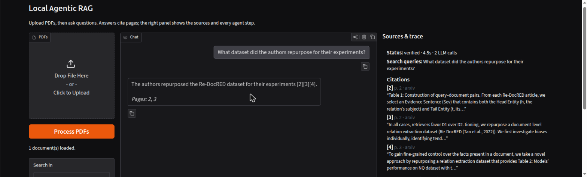
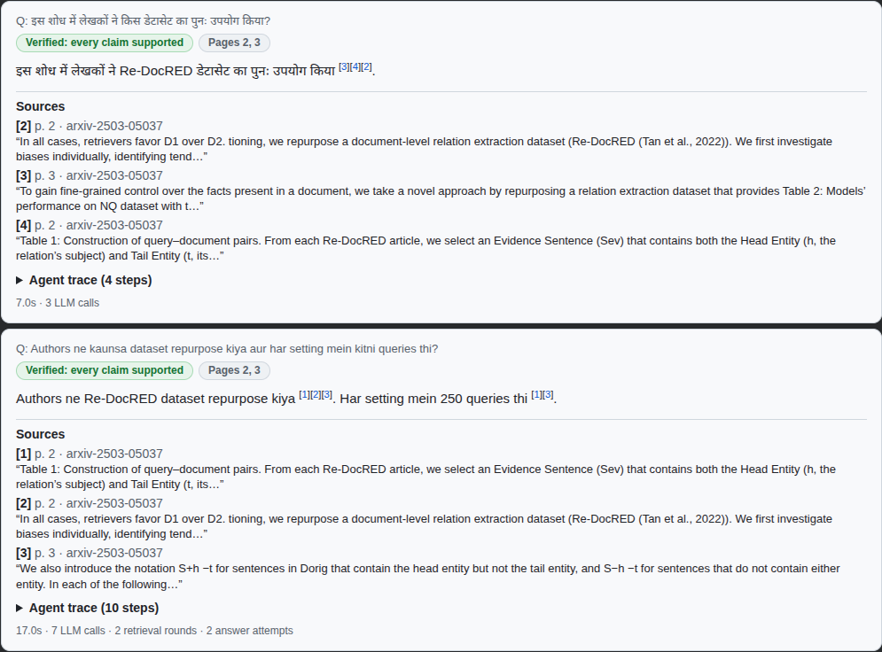

# Local Agentic RAG for PDFs

Ask questions about any PDF and get answers **with page citations**, using only
open-weight models running locally. The whole system fits on a **free Google
Colab T4**.

```
PDF ─► PyMuPDF (reading order, tables, header/footer strip, OCR eng+hin+mar)
    ─► heading-aware 320-token chunks
    ─► hybrid retrieval: BGE-M3 (multilingual) + Unicode BM25 ─► RRF ─► bge-reranker-v2-m3
    ─► agent: GENERATE ─► VERIFY ─► (refused/unsupported? PLAN ─► RE-RETRIEVE ─► GRADE ─► REGENERATE ─► VERIFY)
    ─► answer with [n] citations → pages, or an explicit "not in the document"
```

* **Grounded:** the model only sees numbered passages and must cite them. Invalid
  citations are dropped, and a verifier step checks every claim against the passages.
* **Agentic where it pays off (measured):** every answer is verified against its
  passages. Only when the first answer is refused or unsupported does the agent
  escalate: it decomposes the question, re-retrieves, grades the evidence and
  regenerates with feedback. Follow-up questions are rewritten using chat history.
  An always-on loop was measured to be *worse* than this; see docs/RESULTS.md.
* **Multilingual:** documents and questions can be in different languages (English,
  Hindi, Hinglish, Marathi, and the other languages BGE-M3 covers). Retrieval is
  cross-lingual (BGE-M3 + bge-reranker-v2-m3, Unicode-aware BM25), a translated query is
  added when the question and document scripts differ, answers come back in the
  question's language, and scanned pages are OCR'd (Tesseract eng+hin+mar). Measured on a
  separate 20-question Hindi/Marathi/Hinglish/OCR set; limits in docs/STATUS.md.
* **Robust ingestion:** two-column papers, ruled tables and whitespace-aligned
  statistical tables (rebuilt cell-by-cell), running headers, scanned pages (OCR).
* **Measured:** a 61-question hand-verified benchmark over 3 public PDFs, with
  retrieval and end-to-end ablations against the original baseline.





See [docs/ARCHITECTURE.md](docs/ARCHITECTURE.md) for the design and rationale,
[docs/RESULTS.md](docs/RESULTS.md) for benchmark numbers, and
[docs/STATUS.md](docs/STATUS.md) for what is done and what is outstanding.

## Quick start (Colab)

Open `notebooks/Local_Agentic_RAG.ipynb` in Colab, select **Runtime → Change
runtime type → T4 GPU**, and run the cells in order. The notebook:

1. installs the package and starts an Ollama server with `qwen2.5:7b-instruct`,
2. lets you upload a PDF and ask questions (with a Gradio chat UI),
3. optionally reproduces the benchmark.

## Quick start (Python)

```python
from local_agentic_rag.config import RAGConfig
from local_agentic_rag.pipeline import RAGPipeline
from local_agentic_rag.llm.ollama import OllamaLLM   # or llm.llamacpp.LlamaCppLLM("model.gguf")

llm = OllamaLLM("qwen2.5:7b-instruct"); llm.ensure_ready()
pipe = RAGPipeline(RAGConfig(), llm=llm)
print(pipe.ingest("report.pdf"))
ans = pipe.ask("What was revenue growth in 2024?")
print(ans.answer, ans.cited_pages, ans.grounded)
follow = pipe.ask("And in 2023?", history=[("What was revenue growth in 2024?", ans.answer)])
```

## Results at a glance (measured on a free Colab T4, fresh runtime, final code)

| | English set (61 q) | Multilingual set (20 q) |
|---|---|---|
| Page recall@5, original baseline → default retriever | 73.1% → 92.3% (recall@1 43% → 66%; English-only reranker 96.2%) | English-only → multilingual models: 0.944 → 1.000 |
| Answer accuracy, default adaptive agent | 73.1% [62–85]; single pass 69.2%; original baseline design 50.0% | 88.9% (16/18): Hindi 8/8 (incl. scanned/OCR 2/2), Hinglish 2/3, Marathi 3/3, English→Indic 3/4 |
| Unanswerable questions refused | 9 / 9 | 2 / 2 |
| GPU memory in use (all models loaded) | 8.9 of 15 GB | |

A 4-page progress report with the architecture, benchmarks and plan is in [report/](report/Local_Agentic_RAG_Progress_Report.pdf).
Details, confidence intervals, per-category and per-language breakdowns: [docs/RESULTS.md](docs/RESULTS.md).

## Benchmark

```bash
python benchmark/fetch_pdfs.py                       # downloads the 3 public PDFs (sha256-verified)
python -m local_agentic_rag.bench retrieval          # retrieval ablation, CPU is fine
python -m local_agentic_rag.bench answer --llm ollama:qwen2.5:7b-instruct
# multilingual set (Hindi / Marathi / Hinglish / OCR)
python -m local_agentic_rag.bench answer --benchmark-dir benchmark/multilingual --configs agentic agentic_en
```

## Development

```bash
python -m venv .venv && . .venv/bin/activate
pip install -e ".[dev]"
pytest -q            # offline unit tests (models are faked)
ruff check src tests
```

## License

Not yet licensed: this is a private repository, and a license will be chosen before any
public release. Note that PyMuPDF (the PDF parser) is AGPL-3.0, which affects that choice;
`pypdfium2` is the usual replacement if a permissive license is needed.

The English benchmark PDFs are downloaded from their public sources and are not stored in
the repository. The multilingual test PDFs are generated from Wikipedia text
(CC BY-SA 4.0, attribution in `benchmark/multilingual/README.md`).
